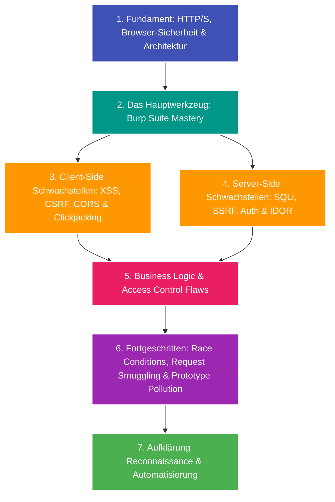

---
tags:
  - Roadmap
  - Security
  - Web Security
  - Bug Bounty
  - PortSwigger
  - OWASP
---

# Lernpfad: Web Security & Bug Bounty Hunting

Dieser Lernpfad führt dich von den absoluten Netzwerk- und HTTP-Grundlagen über den professionellen Einsatz von Burp Suite bis hin zu fortgeschrittenen Angriffstechniken und Aufklärung (Reconnaissance) bei Bug-Bounty-Programmen (z. B. auf HackerOne, Bugcrowd oder Intigriti).

Er orientiert sich didaktisch an den Laboratorien der **PortSwigger Web Security Academy**.

---

## Übersicht & Meilensteine

---

## Phase 1: Die Grundlagen (Das Fundament verstehen)

Bevor man Sicherheitslücken findet, muss man verstehen, wie das Webprotokoll und Webanwendungen auf Byte-Ebene funktionieren:

- [ ] **HTTP/1.1 & HTTP/2 Protokoll:** Verben (`GET`, `POST`, `PUT`, `DELETE`, `OPTIONS`), Statuscodes (2xx, 3xx, 4xx, 5xx), Request/Response-Header und Chunked Transfer Encoding.
- [ ] **State & Sessions:** Cookies (Flags: `HttpOnly`, `Secure`, `SameSite=Strict/Lax/None`), JSON Web Tokens (JWT), LocalStorage vs. SessionStorage.
- [ ] **Browser-Sicherheitsmodelle:**
  - Same-Origin Policy (SOP): Schema, Host und Port.
  - Cross-Origin Resource Sharing (CORS): `Access-Control-Allow-Origin`, Preflight-Requests.
  - Content Security Policy (CSP): Direktiven, Nonces, Hashes und Bypass-Muster.

---

## Phase 2: Das Werkzeug – Burp Suite Mastery

Burp Suite ist der De-facto-Industriestandard für Web Application Penetration Testing. Jeder HTTP-Request wird abgefangen, analysiert und manipuliert:

- [x] **[Burp Suite Grundlagen](../glossary/burp-suite-basics.md):**
  - **Proxy & Intercept:** Einrichten des CA-Zertifikats im Browser, FoxyProxy, Match-and-Replace-Regeln.
  - **Repeater:** Manuelles Modifizieren, schnelles Replayen von Requests und Header-Fuzzing.
  - **Intruder:** Automatisierte Angriffe mit Payload-Typen (Sniper, Battering Ram, Pitchfork, Cluster Bomb).
  - **Decoder & Comparer:** Vergleichen von Antworten auf Byte-Ebene, Dekodieren von URL-, HTML- und Base64-Strings.
  - **Burp Collaborator:** Detektion von Out-of-Band (OAST) Schwachstellen (DNS- und HTTP-Pingbacks).
  - **BApp Store Extensions:** Nützliche Plugins (Autorize, Turbo Intruder, Hackvertor, Param Miner).

---

## Phase 3: Client-Side Schwachstellen

Angriffe, die im Browser des Opfers ausgeführt werden:

- [x] **[Cross-Site Scripting (XSS)](../glossary/web-sec-xss.md):**
  - **Reflected XSS:** Payload wird unmittelbar in der Server-Antwort reflektiert.
  - **Stored XSS:** Schadcode wird persistent in der Datenbank gespeichert (z. B. Kommentarfeld).
  - **DOM-based XSS:** Schwachstellen direkt im clientseitigen JavaScript (Sources wie `location.search` und Sinks wie `innerHTML`, `eval()`).
  - **WAF-Evasion & CSP-Bypasses:** HTML-Entity-Encoding, SVG-Attribute, Script-Gadgets.
- [ ] **Cross-Site Request Forgery (CSRF):** Unbeabsichtigte Aktionen im Namen authentifizierter Opfer (Bypass von `SameSite`, fehlende CSRF-Tokens).
- [ ] **Cross-Origin Resource Sharing (CORS) Misconfigurations:** Dynamische Spiegelung des `Origin`-Headers mit `Access-Control-Allow-Credentials: true`.
- [ ] **Clickjacking:** UI-Redressing über unsichtbare `<iframe>`-Überlagerungen (Fehlender `X-Frame-Options` oder `frame-ancestors`-Header).

---

## Phase 4: Server-Side Schwachstellen

Angriffe, die direkt den Server, dessen Datenbank oder das Backend-Netzwerk kompromittieren:

- [x] **[SQL Injection (SQLi)](../glossary/web-sec-sqli.md):**
  - **In-Band / Union-Based:** Daten direkt im Response-Body über `UNION SELECT` auslesen.
  - **Error-Based:** Datenbank zwingen, sensible Daten in Fehlermeldungen preiszugeben.
  - **Blind SQLi (Boolean-based & Time-based):** Extrahieren von Daten Bit für Bit anhand von Verhaltensänderungen oder künstlichen Pausen (`pg_sleep()`, `WAITFOR DELAY`).
- [x] **[Server-Side Request Forgery (SSRF)](../glossary/web-sec-ssrf.md):**
  - Server zwingen, Requests an interne Systeme oder Cloud-Metadaten-Dienste (`http://169.254.169.254/latest/meta-data/`) zu senden.
  - Bypasses: DNS Rebinding, IPv6-Repräsentationen, URL-Parsing-Inkonsistenzen.
- [x] **[Broken Access Control & IDOR](../glossary/web-sec-access-control-idor.md):**
  - Insecure Direct Object References (IDOR): Ändern von Parameterwerten (`/api/users/1024` zu `/api/users/1025`) ohne Autorisierungsprüfung.
  - Vertikale vs. horizontale Rechteausweitung (Privilege Escalation).
- [ ] **Command Injection & Path Traversal:** Ausführen von Betriebssystembefehlen oder Auslesen sensibler Dateien (`/etc/passwd`, `win.ini`) über `../../`.
- [ ] **Server-Side Template Injection (SSTI):** Codeausführung über Template-Engines (Jinja2, Twig, FreeMarker, Thymeleaf).

---

## Phase 5: Business Logic Flaws & Authentifizierung

Schwachstellen, die nicht auf technischem Syntax-Fehlverhalten basieren, sondern auf fehlerhaften Annahmen im Entwickler-Design:

- [ ] **Business Logic Flaws:** Negative Beträge im Warenkorb, Umgehung von zweistufigen Bestellprozessen, Rabattcode-Wiederverwendung.
- [ ] **Authentication Flaws:** Brute-Force ohne Rate-Limiting, Password-Reset-Poisoning via `Host`-Header, unsichere Multi-Faktor-Authentifizierung (MFA Bypasses).
- [ ] **JWT (JSON Web Token) Schwachstellen:** `alg: none` Angriffe, schwache HMAC-Secrets, Signature-Bypasses durch Key Confusion (`RS256` zu `HS256`).

---

## Phase 6: Fortgeschrittene Web-Angriffe

Sicherheitslücken, die tiefes Verständnis von Proxies, Parsing und asynchroner Verarbeitung erfordern:

- [ ] **HTTP Request Smuggling:** Desynchronisation zwischen Frontend-Reverse-Proxy und Backend über widersprüchliche `Content-Length`- und `Transfer-Encoding: chunked`-Header (CL.TE, TE.CL, TE.TE).
- [ ] **Race Conditions (Limit Overrun):** Gleichzeitiges Senden von parallelen Requests in einem einzigen TCP-Paket (Single-Packet Attack via Turbo Intruder), um Gutscheine mehrfach einzulösen.
- [ ] **Prototype Pollution (JavaScript):** Überschreiben von `Object.prototype` in Node.js-Backends oder im Client zur Remotecode-Ausführung oder XSS.

---

## Phase 7: Bug Bounty Hunting – Reconnaissance & Automatisierung

Bei echten Programmen (Scope: `*.target.com`) gewinnt oft derjenige, der neue oder vergessene Assets zuerst entdeckt:

- [ ] **Asset Discovery (Subdomain Enumeration):**
  - Passiv: Certificate Transparency Logs (`crt.sh`), Amass, Sublist3r.
  - Aktiv: DNS Brute-Forcing (`puredns`, `shuffledns`), Permutationen (`altdns`).
- [ ] **Port Scanning & Service Fingerprinting:** `nmap`, `masscan`, `naabu`, `httpx` (Herausfiltern aktiver Webserver).
- [ ] **Content Discovery & Endpunktsuche:**
  - Directory Brute-Forcing: `ffuf`, `feroxbuster` mit SecLists.
  - JavaScript-Analyse: Extrahieren verborgener API-Endpunkte und API-Keys aus `.js`-Bundles (`katana`, `gau`, `waybackurls`).
- [ ] **Parameter Fuzzing & Hidden Inputs:** `arjun`, Param Miner.
- [ ] **Schwachstellen-Scanning mit Augenmaß:** `nuclei` mit maßgeschneiderten Templates für bekannte CVEs und Fehlkonfigurationen.
- [ ] **Verantwortungsvolles Reporting:** Klare Reproduktionsschritte (PoC), Schadensnachweis (Impact) und Remediation-Tipps nach CVSS-Standard verfassen.
