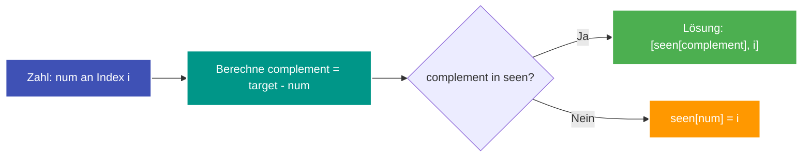

---
tags:
  - LeetCode
  - Array
  - Hash Table
  - Easy
---


# LeetCode 1: Two Sum

- **Plattform:** [LeetCode #1](https://leetcode.com/problems/two-sum/)
- **Schwierigkeit:** Easy
- **Kategorien:** Array, Hash Table
- **Verwandte Konzepte:** [Hash Map & Hash Set](../glossary/hash-map.md)

---

## Aufgabenstellung

Gegeben ist ein Array von Ganzzahlen `nums` und eine Ganzzahl `target`. Gesucht sind die Indizes der beiden Zahlen, deren Summe genau `target` ergibt.

Jede Eingabe hat genau eine eindeutige Lösung. Dasselbe Element darf nicht zweimal verwendet werden. Die Reihenfolge der zurückgegebenen Indizes spielt keine Rolle.

### Beispiele

```text
Input:  nums = [2, 7, 11, 15], target = 9
Output: [0, 1]
Erklärung: nums[0] + nums[1] == 2 + 7 == 9
```

---

## Intuition & Lösungsansatz

### 1. Naive Idee (Brute Force)
Zwei ineinander verschachtelte Schleifen vergleichen jedes mögliche Paar $(i, j)$ mit $i \neq j$.
- Laufzeit: $\mathcal{O}(n^2)$
- Problem: Bei großen Arrays mit zehntausenden Elementen führt der quadratische Aufwand zu einem Time Limit Exceeded (TLE).

### 2. Optimierte Kernidee (Hash Map / Komplement-Lookup)
Für jede Zahl `num` an Index `i` suchen wir das Gegenstück:
$$\text{complement} = \text{target} - \text{num}$$

Statt das gesamte Array linear nach `complement` zu durchsuchen, speichern wir bereits gesehene Zahlen mit ihrem Index in einer [Hash Map](../glossary/hash-map.md) (`seen[num] = i`).
- Bei jedem Schritt prüfen wir zuerst, ob `complement` bereits im Wörterbuch existiert.
- Falls ja, haben wir das passende Paar gefunden und geben `[seen[complement], i]` zurück.
- Falls nein, tragen wir die aktuelle Zahl in das Wörterbuch ein.



---

## Implementierung (Python 3)

```python
from typing import List


class Solution:
    def twoSum(self, nums: List[int], target: int) -> List[int]:
        """Findet die zwei Indizes im Array nums, deren Summe target ergibt.

        Args:
            nums: Liste von Ganzzahlen
            target: Zielsumme

        Returns:
            Liste mit den beiden Indizes [index1, index2]
        """
        seen = {}
        for i, num in enumerate(nums):
            complement = target - num
            if complement in seen:
                return [seen[complement], i]
            seen[num] = i

        return []
```

---

## Komplexitätsanalyse

| Dimension | Komplexität | Begründung |
| :--- | :--- | :--- |
| **[Zeitkomplexität](../glossary/o-notation.md)** | $\mathcal{O}(n)$ | Wir iterieren genau einmal durch das Array der Länge $n$. Das Nachschlagen und Einfügen in das Python-Dictionary benötigt durchschnittlich $\mathcal{O}(1)$. |
| **[Speicherkomplexität](../glossary/o-notation.md)** | $\mathcal{O}(n)$ | Im schlechtesten Fall werden bis zu $n$ Elemente in der [Hash Map](../glossary/hash-map.md) abgelegt. |

---

## Edge Cases & Fallstricke

- [x] **Duplikate im Input:** Haben zwei Elemente denselben Wert (z. B. `[3, 3]`, `target = 6`), findet der Lookup bei der zweiten `3` die erste `3` direkt in `seen`, bevor sie überschrieben wird.
- [x] **Negative Zahlen:** Mathematisch identisch, da $\text{target} - \text{num}$ auch für negative Vorzeichen korrekt aufgelöst wird.
- [x] **Kein Element zweimal verwenden:** Da erst geprüft wird und das aktuelle Element erst danach zu `seen` hinzugefügt wird, kann ein Element sich nicht selbst als Partner wählen.
