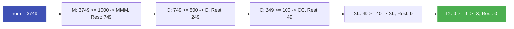

---
tags:
  - LeetCode
  - Math
  - String
  - Greedy
  - Medium
---


# LeetCode 12: Integer to Roman

- **Plattform:** [LeetCode #12](https://leetcode.com/problems/integer-to-roman/)
- **Schwierigkeit:** Medium
- **Kategorien:** Math, String, Greedy
- **Verwandte Konzepte:** [Römische Zahlen & Ziffernsysteme](../glossary/roman-numerals.md)

---

## Aufgabenstellung

Gegeben ist eine Ganzzahl `num` im Bereich von $1$ bis $3999$. Konvertiere diese Ganzzahl in ihre römische Zahlendarstellung als String.

### Römische Symbole & Werte

| Symbol | Wert | Symbol | Wert |
| :---: | :---: | :---: | :---: |
| **I** | 1 | **V** | 5 |
| **X** | 10 | **L** | 50 |
| **C** | 100 | **D** | 500 |
| **M** | 1000 | | |

Ausnahmen für Subtraktionen: $4 \to \text{IV}$, $9 \to \text{IX}$, $40 \to \text{XL}$, $90 \to \text{XC}$, $400 \to \text{CD}$, $900 \to \text{CM}$.

### Beispiele

```text
Input:  num = 3749
Output: "MMMDCCXLIX"
Erklärung: 3000 = MMM, 700 = DCC, 40 = XL, 9 = IX

Input:  num = 58
Output: "LVIII"
Erklärung: 50 = L, 8 = VIII
```

---

## Intuition & Lösungsansatz

### 1. Greedy-Ansatz mit Lookup-Tabelle
Das römische Ziffernsystem ist streng hierarchisch aufgebaut. Wir definieren eine absteigend sortierte Tabelle aller 13 möglichen Werte (einschließlich der 6 Subtraktionsfälle).

Wir gehen die Tabelle von oben nach unten durch:
- Solange `num >= val`, hängen wir das Symbol an und ziehen `val` ab.
- Sobald `num < val`, gehen wir zum nächstkleineren Wert.



### 2. Tabellarischer O(1)-Lookup nach Stellenwerten
Da der Wertebereich auf $1 \le \text{num} \le 3999$ beschränkt ist, können Tausender, Hunderter, Zehner und Einer direkt über Tupel-Indizes abgegriffen werden:
- Tausender: `num // 1000`
- Hunderter: `(num % 1000) // 100`
- Zehner: `(num % 100) // 10`
- Einer: `num % 10`

---

## Implementierung (Python 3)

### Standard-Lösung (Greedy-Schleife)

```python
class Solution:
    def intToRoman(self, num: int) -> str:
        """Wandelt eine Ganzzahl num in eine römische Zahl um.

        Args:
            num: Ganzzahl zwischen 1 und 3999

        Returns:
            Römische Zahlendarstellung als String
        """
        val_map = [
            (1000, "M"),
            (900, "CM"),
            (500, "D"),
            (400, "CD"),
            (100, "C"),
            (90, "XC"),
            (50, "L"),
            (40, "XL"),
            (10, "X"),
            (9, "IX"),
            (5, "V"),
            (4, "IV"),
            (1, "I"),
        ]

        result = []
        for val, symbol in val_map:
            while num >= val:
                result.append(symbol)
                num -= val

        return "".join(result)
```

### High-Speed Tabellen-Lookup

```python
class SolutionLookup:
    def intToRoman(self, num: int) -> str:
        thousands = ("", "M", "MM", "MMM")[num // 1000]
        hundreds = ("", "C", "CC", "CCC", "CD", "D", "DC", "DCC", "DCCC", "CM")[
            (num % 1000) // 100
        ]
        tens = ("", "X", "XX", "XXX", "XL", "L", "LX", "LXX", "LXXX", "XC")[
            (num % 100) // 10
        ]
        ones = ("", "I", "II", "III", "IV", "V", "VI", "VII", "VIII", "IX")[
            num % 10
        ]
        return thousands + hundreds + tens + ones
```

---

## Komplexitätsanalyse

| Dimension | Komplexität | Begründung |
| :--- | :--- | :--- |
| **[Zeitkomplexität](../glossary/o-notation.md)** | $\mathcal{O}(1)$ | Da die Zahl auf $3999$ gedeckelt ist, führt die Schleife maximal 15 Durchläufe aus. |
| **[Speicherkomplexität](../glossary/o-notation.md)** | $\mathcal{O}(1)$ | Feste Tabelle, maximal 15 Zeichen für das Ergebnis. |

---

## Edge Cases & Fallstricke

- [x] **Subtraktive Ziffern:** 4 (`IV`), 9 (`IX`), 40 (`XL`), 90 (`XC`), 400 (`CD`), 900 (`CM`) sind explizit in der Wertetabelle enthalten.
- [x] **Größte Zahl 3999:** Ergibt `"MMMCMXCIX"` ohne Überläufe.
- [x] **Kleinste Zahl 1:** Ergibt `"I"`.
