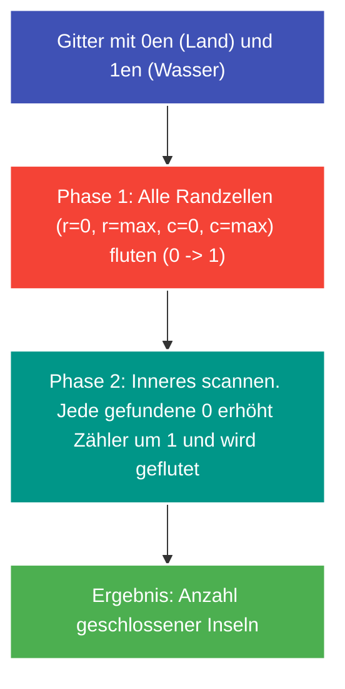

---
tags:
  - LeetCode
  - Array
  - DFS
  - BFS
  - Matrix
  - Medium
---


# LeetCode 1254: Number of Closed Islands

- **Plattform:** [LeetCode #1254](https://leetcode.com/problems/number-of-closed-islands/)
- **Schwierigkeit:** Medium
- **Kategorien:** Array, DFS, BFS, Matrix
- **Verwandte Konzepte:** [Flood Fill & Gitter-Traversierung](../glossary/flood-fill.md)

---

## Aufgabenstellung

Gegeben ist ein 2D-Gitter `grid` bestehend aus `0`en (Land) und `1`en (Wasser). Eine Insel ist eine maximal 4-fach orthogonal zusammenhängende Gruppe von Landfeldern (`0`).

Eine **geschlossene Insel** ist vollständig (oben, unten, links, rechts) von Wasserfeldern (`1`) umschlossen und berührt **keinen** Rand des Gitters.

Gesucht ist die Anzahl der geschlossenen Inseln.

### Beispiele

```text
Input: grid = [
  [1,1,1,1,1,1,1,0],
  [1,0,0,0,0,1,1,0],
  [1,0,1,0,1,1,1,0],
  [1,0,0,0,0,1,0,1],
  [1,1,1,1,1,1,1,0]
]
Output: 2
```

---

## Intuition & Lösungsansatz

### 1. Naive Idee
Starte von jeder Insel eine DFS und prüfe mit einem booleschen Flag, ob während der Traversierung jemals eine Zelle auf dem Gitterrand berührt wird.
- Nachteil: Umständliche Fehlerbehandlung bei der Aggregation rekursiver Rückgabewerte.

### 2. Optimierte Kernidee (Randeliminierung via Flood Fill)
Ein extrem eleganter **Zwei-Phasen-Ansatz**:

1. **Phase 1: Rand-Inseln eliminieren**
   - Jede Landzelle (`0`), die auf dem Rand des Gitters liegt ($r \in \{0, \text{rows}-1\}$ oder $c \in \{0, \text{cols}-1\}$), kann per Definition niemals Teil einer geschlossenen Insel sein.
   - Wir fluten diese Rand-Landzellen und alle mit ihnen verbundenen Landzellen sofort mit einer DFS und verwandeln sie in Wasser (`1`).
2. **Phase 2: Innere Inseln zählen**
   - Alle jetzt noch vorhandenen Landzellen (`0`) im Gitter sind garantiert vollständig von Wasser umschlossen.
   - Wir scannen das Gitter: Finden wir eine `0`, erhöhen wir den Zähler um 1 und fluten die gesamte gefundene Insel, damit sie nicht doppelt gezählt wird.



### 3. Iterative DFS gegen Stack-Überläufe
Bei Gittern bis $100 \times 100$ kann die Rekursionstiefe das Standard-Python-Limit strapazieren. Ein iterativer Stack (`stack.pop()`) garantiert absolute Robustheit.

---

## Implementierung (Python 3)

```python
from typing import List


class Solution:
    def closedIsland(self, grid: List[List[int]]) -> int:
        """Zählt alle Inseln, die vollständig von Wasser umgeben sind.

        Args:
            grid: 2D-Gitter (0 = Land, 1 = Wasser)

        Returns:
            Anzahl der geschlossenen Inseln
        """
        rows, cols = len(grid), len(grid[0])

        def flood_fill(start_r: int, start_c: int) -> None:
            # Iterative DFS mit Stack (vermeidet RecursionError)
            stack = [(start_r, start_c)]
            grid[start_r][start_c] = 1

            while stack:
                r, c = stack.pop()
                for dr, dc in ((1, 0), (-1, 0), (0, 1), (0, -1)):
                    nr, nc = r + dr, c + dc
                    if 0 <= nr < rows and 0 <= nc < cols and grid[nr][nc] == 0:
                        grid[nr][nc] = 1  # In-Place als geflutet markieren
                        stack.append((nr, nc))

        # 1. Alle Inseln am Rand eliminieren
        for r in range(rows):
            for c in range(cols):
                if (
                    r == 0 or r == rows - 1 or c == 0 or c == cols - 1
                ) and grid[r][c] == 0:
                    flood_fill(r, c)

        # 2. Verbleibende geschlossene Inseln im Inneren zählen
        closed_islands = 0
        for r in range(rows):
            for c in range(cols):
                if grid[r][c] == 0:
                    closed_islands += 1
                    flood_fill(r, c)

        return closed_islands
```

---

## Komplexitätsanalyse

| Dimension | Komplexität | Begründung |
| :--- | :--- | :--- |
| **[Zeitkomplexität](../glossary/o-notation.md)** | $\mathcal{O}(m \cdot n)$ | Jede Zelle des Gitters wird maximal einmal besucht und auf 1 gesetzt. |
| **[Speicherkomplexität](../glossary/o-notation.md)** | $\mathcal{O}(m \cdot n)$ | Für den expliziten Stack im ungünstigsten Fall, wenn das Gitter überwiegend aus Land besteht. Kein zusätzliches visited-Array nötig (In-Place). |

---

## Edge Cases & Fallstricke

- [x] **Inseln, die nur an einer Ecke den Rand berühren:** Werden in Phase 1 durch orthogonale Nachbarschaftssuche zuverlässig mitgeflutet.
- [x] **Gitter besteht nur aus Wasser (`1`):** Beide Schleifen laufen durch, Rückgabe ist korrekt 0.
- [x] **Gitter ohne Rand-Land:** Phase 1 tut nichts, Phase 2 zählt alle inneren Inseln.
