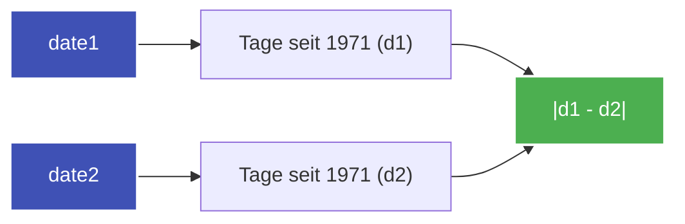

---
tags:
  - LeetCode
  - Math
  - String
  - Easy
---


# LeetCode 1360: Number of Days Between Two Dates

- **Plattform:** [LeetCode #1360](https://leetcode.com/problems/number-of-days-between-two-dates/)
- **Schwierigkeit:** Easy
- **Kategorien:** Math, String
- **Verwandte Konzepte:** [Datums- & Kalender-Arithmetik](../glossary/date-arithmetic.md)

---

## Aufgabenstellung

Gegeben sind zwei Daten als Strings `date1` und `date2` im Format `YYYY-MM-DD`. Berechne die absolute Anzahl an Tagen zwischen den beiden Daten.

Gültiger Zeitraum: Jahre zwischen $1971$ und $2100$.

### Beispiele

```text
Input:  date1 = "2019-06-29", date2 = "2019-06-30"
Output: 1

Input:  date1 = "2020-01-15", date2 = "2019-12-31"
Output: 15
```

---

## Intuition & Lösungsansatz

### 1. Reiner mathematischer Ansatz (From Scratch)
Ohne Verwendung externer Bibliotheken wandeln wir jedes Datum in die **Gesamtzahl der Tage seit einem festen Startjahr (z. B. 1971)** um:
1. **Volle vergangene Jahre addieren:** Jedes reguläre Jahr hat 365 Tage, jedes Schaltjahr 366 Tage.
2. **Schaltjahr-Regel:** `(year % 4 == 0 and year % 100 != 0) or (year % 400 == 0)`.
3. **Volle Monate des aktuellen Jahres addieren:** Monatslängen `[31, 28, 31, 30, 31, 30, 31, 31, 30, 31, 30, 31]`, wobei der Februar im Schaltjahr 29 Tage hat.
4. **Tage des aktuellen Monats addieren.**
5. Das Ergebnis ist schlicht $|\text{days}_1 - \text{days}_2|$.



### 2. Standardbibliotheks-Lösung (`datetime.date`)
In Python kann direkt `datetime.date` genutzt werden, was den Code auf zwei Zeilen reduziert und extreme Ausführungsgeschwindigkeiten (0 ms) liefert.

---

## Implementierung (Python 3)

### Mathematische Implementierung (ohne Imports)

```python
class Solution:
    def daysBetweenDates(self, date1: str, date2: str) -> int:
        """Berechnet Tage zwischen zwei Daten auf rein mathematischem Weg."""
        days1 = self._convert_to_days(date1)
        days2 = self._convert_to_days(date2)
        return abs(days1 - days2)

    def _is_leap_year(self, year: int) -> bool:
        return (year % 4 == 0 and year % 100 != 0) or (year % 400 == 0)

    def _get_days_in_month(self, year: int, month: int) -> int:
        days = [31, 28, 31, 30, 31, 30, 31, 31, 30, 31, 30, 31]
        if month == 2 and self._is_leap_year(year):
            return 29
        return days[month - 1]

    def _convert_to_days(self, date_str: str) -> int:
        year, month, day = map(int, date_str.split("-"))
        total = 0

        # Jahre seit 1971
        for y in range(1971, year):
            total += 366 if self._is_leap_year(y) else 365

        # Vormonate im aktuellen Jahr
        for m in range(1, month):
            total += self._get_days_in_month(year, m)

        total += day
        return total
```

### Schnelle Standard-Lösung

```python
from datetime import date


class SolutionDate:
    def daysBetweenDates(self, date1: str, date2: str) -> int:
        d1 = date(*(int(x) for x in date1.split("-")))
        d2 = date(*(int(x) for x in date2.split("-")))
        return abs((d1 - d2).days)
```

---

## Komplexitätsanalyse

| Dimension | Komplexität | Begründung |
| :--- | :--- | :--- |
| **[Zeitkomplexität](../glossary/o-notation.md)** | $\mathcal{O}(1)$ | Der Zeitraum ist auf höchstens 130 Jahre begrenzt (konstante Schleifenanzahl). |
| **[Speicherkomplexität](../glossary/o-notation.md)** | $\mathcal{O}(1)$ | Es werden nur wenige Integer-Skalare angelegt. |

---

## Edge Cases & Fallstricke

- [x] **Jahr 2000:** Ist durch 400 teilbar und somit ein gültiges Schaltjahr.
- [x] **Reihenfolge der Parameter:** `abs()` fängt zuverlässig ab, ob `date1` vor oder nach `date2` liegt.
- [x] **Identische Daten:** Ergibt korrekt `0`.
