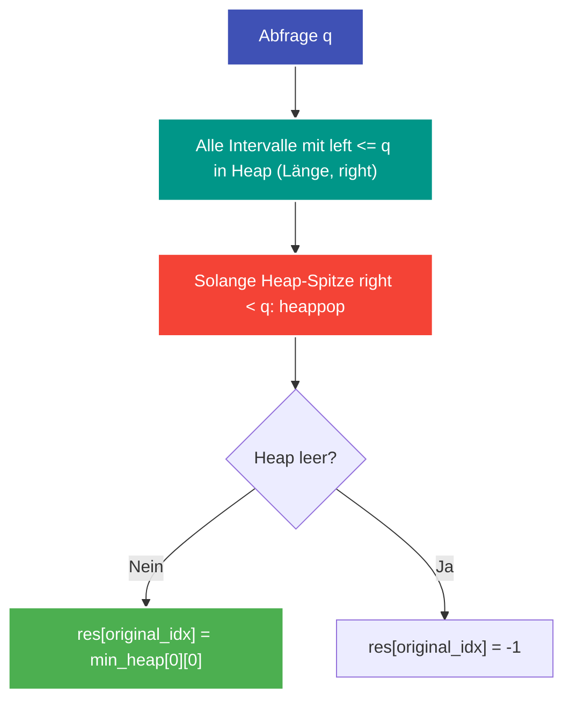

---
tags:
  - LeetCode
  - Array
  - Binary Search
  - Heap
  - Priority Queue
  - Sweep Line
  - Hard
---


# LeetCode 1851: Minimum Interval to Include Each Query

- **Plattform:** [LeetCode #1851](https://leetcode.com/problems/minimum-interval-to-include-each-query/)
- **Schwierigkeit:** Hard
- **Kategorien:** Array, [Binary Search](../glossary/binary-search.md), Heap ([Priority Queue](../glossary/min-heap-sweep-line.md)), Sweep Line, Sorting
- **Verwandte Konzepte:** [Min-Heap & Sweep-Line für Intervalle](../glossary/min-heap-sweep-line.md)

---

## Aufgabenstellung

Gegeben sind ein 2D-Ganzzahl-Array `intervals`, wobei $\text{intervals}[i] = [\text{left}_i, \text{right}_i]$ ein geschlossenes Intervall der Größe $\text{right}_i - \text{left}_i + 1$ darstellt, sowie ein Array `queries`.

Für jede Abfrage $\text{queries}[j]$ soll die **minimale Größe** eines Intervalls gefunden werden, das $\text{queries}[j]$ enthält ($\text{left}_i \le \text{queries}[j] \le \text{right}_i$). Falls kein solches Intervall existiert, ist die Antwort $-1$.

Gib ein Array mit den Antworten für alle Abfragen in ihrer ursprünglichen Reihenfolge zurück.

### Beispiele

```text
Input:  intervals = [[1, 4], [2, 4], [3, 6], [4, 4]], queries = [2, 3, 4, 5]
Output: [3, 3, 1, 4]
Erklärung:
- Query 2: Intervalle [1, 4] (Größe 4) und [2, 4] (Größe 3) enthalten 2. Minimum = 3.
- Query 3: Intervalle [1, 4] (4), [2, 4] (3), [3, 6] (4). Minimum = 3.
- Query 4: Intervall [4, 4] (Größe 1). Minimum = 1.
- Query 5: Intervall [3, 6] (Größe 4). Minimum = 4.
```

---

## Intuition & Lösungsansatz

### 1. Naive Idee (Brute Force)
Prüfe für jede Abfrage alle $n$ Intervalle.
- Laufzeit: $\mathcal{O}(k \cdot n)$ mit $k = |\text{queries}|, n = |\text{intervals}|$.
- Bei $n, k \le 10^5$ ergibt das $10^{10}$ Operationen $\to$ Time Limit Exceeded (TLE).

### 2. Optimierte Kernidee (Sweep-Line + Min-Heap)
Wir transformieren das statische Problem in ein dynamisches Ereignis-Problem, indem wir beide Eingaben **nach Koordinaten sortieren**:

1. **Sortierung:**
   - Sortiere `intervals` aufsteigend nach dem Startpunkt `left`.
   - Sortiere `queries` aufsteigend, speichere aber den **Original-Index** `(q, original_idx)` mit ab.
2. **[Min-Heap](../glossary/min-heap-sweep-line.md) (Vorrangswarteschlange):**
   - Im Heap speichern wir Tupel `(länge, right)`. Dadurch liegt das kürzeste Intervall immer oben (`heap[0]`).
3. **Für jede sortierte Abfrage $q$:**
   - **Hinzufügen:** Alle Intervalle, deren Startpunkt $\text{left} \le q$ ist, werden in den Heap geschoben (`heappush`).
   - **Lazy Invalidation:** Alle Intervalle an der Heap-Spitze, deren Endpunkt $\text{right} < q$ ist, sind für $q$ und alle weiteren Abfragen abgelaufen und werden verworfen (`heappop`).
   - **Ergebnis notieren:** Liegt noch ein Element im Heap, ist `min_heap[0][0]` die kleinste gültige Länge. Andernfalls bleibt $-1$ stehen.



---

## Implementierung (Python 3)

```python
import heapq
from typing import List


class Solution:
    def minInterval(
        self, intervals: List[List[int]], queries: List[int]
    ) -> List[int]:
        """Ermittelt für jede Abfrage das kleinste umfassende Intervall.

        Args:
            intervals: Liste von Intervallen [left, right]
            queries: Liste von Abfragewerten

        Returns:
            Liste minimaler Intervalllängen (-1 falls keines existiert)
        """
        # 1. Intervalle nach Startpunkt sortieren
        intervals.sort(key=lambda x: x[0])

        # 2. Queries sortieren unter Beibehaltung des Originalindex
        sorted_queries = sorted((q, i) for i, q in enumerate(queries))

        res = [-1] * len(queries)
        min_heap = []
        interval_idx = 0
        n_intervals = len(intervals)

        # 3. Sweep-Line über alle sortierten Queries
        for q, orig_idx in sorted_queries:
            # Intervalle pushen, die bei oder vor q starten
            while (
                interval_idx < n_intervals
                and intervals[interval_idx][0] <= q
            ):
                left, right = intervals[interval_idx]
                length = right - left + 1
                heapq.heappush(min_heap, (length, right))
                interval_idx += 1

            # Veraltete Intervalle von der Heap-Spitze entfernen
            while min_heap and min_heap[0][1] < q:
                heapq.heappop(min_heap)

            # Oberstes Element ist das kleinste Intervall, das q enthält
            if min_heap:
                res[orig_idx] = min_heap[0][0]

        return res
```

---

## Komplexitätsanalyse

| Dimension | Komplexität | Begründung |
| :--- | :--- | :--- |
| **[Zeitkomplexität](../glossary/o-notation.md)** | $\mathcal{O}(n \log n + k \log k)$ | Sortieren der $n$ Intervalle und $k$ Queries. Jedes der $n$ Intervalle wird höchstens einmal in den Heap eingefügt und maximal einmal entfernt ($\mathcal{O}(n \log n)$). |
| **[Speicherkomplexität](../glossary/o-notation.md)** | $\mathcal{O}(n + k)$ | Heap speichert bis zu $n$ Intervalle, sortierte Queries und Ergebnisarray benötigen $\mathcal{O}(k)$. |

---

## Edge Cases & Fallstricke

- [x] **Kein passendes Intervall:** Heap wird komplett geleert $\to$ bleibt standardmäßig $-1$.
- [x] **Mehrere Intervalle gleicher Länge:** Der Heap nimmt den kleinsten Wert; die zusätzliche Bindung an `right` im Tupel bricht Gleichstände deterministisch.
- [x] **Abfragen außerhalb aller Intervalle:** Werden vor oder nach den Intervallen problemlos mit $-1$ beantwortet.
