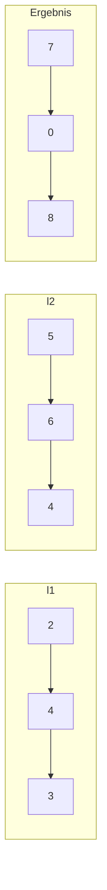

---
tags:
  - LeetCode
  - Linked List
  - Math
  - Recursion
  - Medium
---


# LeetCode 2: Add Two Numbers

- **Plattform:** [LeetCode #2](https://leetcode.com/problems/add-two-numbers/)
- **Schwierigkeit:** Medium
- **Kategorien:** [Linked List](../glossary/linked-list.md), Math, Simulation
- **Verwandte Konzepte:** [Verkettete Liste](../glossary/linked-list.md)

---

## Aufgabenstellung

Gegeben sind zwei nicht-leere einfach [verkettete Listen](../glossary/linked-list.md) (`ListNode`), die jeweils eine nicht-negative Ganzzahl darstellen. Die Ziffern sind in **umgekehrter Reihenfolge** gespeichert, sodass der Kopfknoten der Liste die Einerziffer enthält.

Addiere die beiden Zahlen und gib das Ergebnis als [[verkettete Liste](../glossary/linked-list.md)](../glossary/linked-list.md) zurück. Die Eingabezahlen enthalten keine führenden Nullen, außer der Zahl $0$ selbst.

### Beispiele

```text
Input:  l1 = [2, 4, 3], l2 = [5, 6, 4]
Output: [7, 0, 8]
Erklärung: 342 + 465 = 807
```



---

## Intuition & Lösungsansatz

### 1. Naive Idee (String-/Zahlen-Umwandlung)
Man wandelt beide Listen in Integers um, addiert diese und baut aus dem Ergebnis-String eine neue Liste.
- Flaschenhals: Bei sehr großen Listen (über 100 Ziffern) ist dies in typischen Sprachen wegen Typgrenzen problematisch und verfehlt das Ziel, Zeiger-Operationen auf verketteten Listen zu üben.

### 2. Optimierte Kernidee (Schriftliche Addition mit Dummy Head)
Da die Ziffern bereits in umgekehrter Reihenfolge (Einerziffer zuerst) vorliegen, entspricht die Traversierung exakt der schriftlichen Addition aus der Grundschule:
1. Wir laufen synchron durch beide Listen.
2. Für jede Stelle addieren wir:
   $$\text{total} = \text{val}_1 + \text{val}_2 + \text{carry}$$
3. Der neue Ziffernwert für den aktuellen Knoten ist $\text{total} \pmod{10}$.
4. Der neue Übertrag (*carry*) für die nächste Stelle ist $\lfloor \text{total} / 10 \rfloor$.
5. Die Schleife läuft, solange mindestens eine Liste noch Knoten hat **oder** noch ein Übertrag $\text{carry} \neq 0$ übrig ist.

Ein `dummy_head`-Knoten erleichtert das Anhängen neuer Knoten, ohne Sonderfälle für den Kopfknoten behandeln zu müssen.

---

## Implementierung (Python 3)

```python
from typing import Optional


class ListNode:
    def __init__(self, val: int = 0, next: Optional["ListNode"] = None):
        self.val = val
        self.next = next


class Solution:
    def addTwoNumbers(
        self, l1: Optional[ListNode], l2: Optional[ListNode]
    ) -> Optional[ListNode]:
        """Addiert zwei umgekehrt gespeicherte Zahlen in verketteten Listen.

        Args:
            l1: Erste Zahl als Linked List
            l2: Zweite Zahl als Linked List

        Returns:
            Ergebnisliste als ListNode
        """
        dummy_head = ListNode(0)
        current = dummy_head
        carry = 0

        while l1 is not None or l2 is not None or carry != 0:
            val1 = l1.val if l1 is not None else 0
            val2 = l2.val if l2 is not None else 0

            total_sum = val1 + val2 + carry
            carry = total_sum // 10
            new_digit = total_sum % 10

            current.next = ListNode(new_digit)
            current = current.next

            if l1 is not None:
                l1 = l1.next
            if l2 is not None:
                l2 = l2.next

        return dummy_head.next
```

---

## Komplexitätsanalyse

| Dimension | Komplexität | Begründung |
| :--- | :--- | :--- |
| **[Zeitkomplexität](../glossary/o-notation.md)** | $\mathcal{O}(\max(m, n))$ | Wir durchlaufen maximal $\max(m, n) + 1$ Knoten, wobei $m$ und $n$ die Längen der beiden Eingabelisten sind. |
| **[Speicherkomplexität](../glossary/o-notation.md)** | $\mathcal{O}(\max(m, n))$ | Die Ergebnisliste benötigt maximal $\max(m, n) + 1$ neue Knoten. |

---

## Edge Cases & Fallstricke

- [x] **Unterschiedliche Längen:** Wenn eine Liste kürzer ist als die andere (z. B. `[9, 9]` + `[1]`), wird der fehlende Wert als $0$ gewertet.
- [x] **Verbleibender Übertrag am Ende:** Wenn nach der letzten Ziffer noch ein Carry von $1$ übrig bleibt (z. B. $99 + 1 = 100$), erzeugt die Schleifenbedingung `carry != 0` automatisch den finalen Knoten mit Wert $1$.
- [x] **Eingaben mit Null:** $0 + 0 = 0$ wird ohne Ausnahme korrekt abgebildet.
