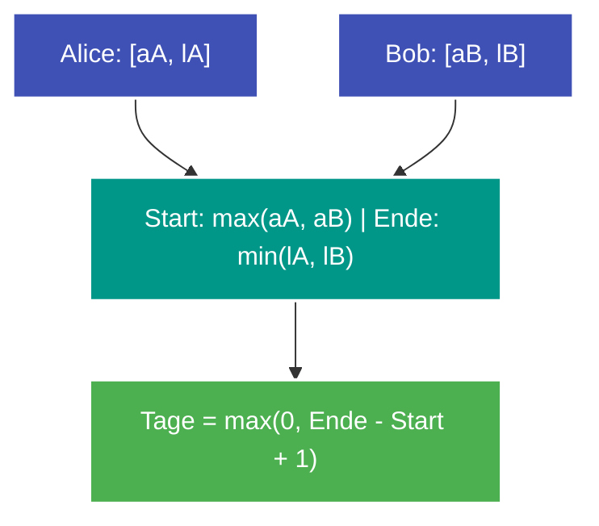

---
tags:
  - LeetCode
  - Math
  - String
  - Easy
---


# LeetCode 2409: Count Days Spent Together

- **Plattform:** [LeetCode #2409](https://leetcode.com/problems/count-days-spent-together/)
- **Schwierigkeit:** Easy
- **Kategorien:** Math, String
- **Verwandte Konzepte:** [Datums- & Kalender-Arithmetik](../glossary/date-arithmetic.md)

---

## Aufgabenstellung

Alice und Bob reisen im selben Jahr nach Rom. Es liegt kein Schaltjahr vor (Februar hat 28 Tage, das Jahr hat 365 Tage).

Gegeben sind vier Datums-Strings im Format `"MM-DD"`:
- `arriveAlice`, `leaveAlice` (Aufenthalt von Alice)
- `arriveBob`, `leaveBob` (Aufenthalt von Bob)

Gesucht ist die **Anzahl der Tage, die beide gemeinsam in Rom verbringen** (Schnittmenge der beiden Zeiträume, inklusive Ankunfts- und Abreisetag).

### Beispiele

```text
Input:  arriveAlice = "08-15", leaveAlice = "08-18", arriveBob = "08-16", leaveBob = "08-19"
Output: 3
Erklärung: Beide sind an den Tagen 16., 17. und 18. August zusammen in Rom -> 3 Tage.

Input:  arriveAlice = "10-01", leaveAlice = "10-31", arriveBob = "11-01", leaveBob = "12-31"
Output: 0
Erklärung: Keine Überschneidung.
```

---

## Intuition & Lösungsansatz

### 1. Naive Idee
Erzeuge zwei Sets mit allen Tagesdaten, die Alice bzw. Bob in Rom verbringen, und bilde die Schnittmenge (`len(set_a & set_b)`).
- Funktioniert, allokiert aber unnötigen Speicher für Sets und Strings.

### 2. Optimierte Kernidee (Intervall-Schnittmenge auf fortlaufenden Tagen)
1. **In fortlaufende Tag-Nummer ($1 \dots 365$) umrechnen:**
   - Mit einem vorberechneten Präfix-Array `days_before` (Tage vor dem jeweiligen Monat) lässt sich jedes `"MM-DD"` in $\mathcal{O}(1)$ in einen absoluten Tag $T \in [1, 365]$ umwandeln:
     $$T = \text{days\_before}[\text{month} - 1] + \text{day}$$
2. **Intervall-Schnittmenge berechnen:**
   - Alice verbringt das geschlossene Intervall $[a_A, l_A]$ in Rom.
   - Bob verbringt das Intervall $[a_B, l_B]$ in Rom.
   - Der gemeinsame Zeitraum beginnt bei $\text{start} = \max(a_A, a_B)$ und endet bei $\text{end} = \min(l_A, l_B)$.
3. **Ergebnis:**
   $$\text{Tage} = \max(0, \text{end} - \text{start} + 1)$$



---

## Implementierung (Python 3)

```python
class Solution:
    def countDaysTogether(
        self,
        arriveAlice: str,
        leaveAlice: str,
        arriveBob: str,
        leaveBob: str,
    ) -> int:
        """Berechnet die gemeinsamen Aufenthaltstage von Alice und Bob in Rom.

        Args:
            arriveAlice: Ankunft Alice "MM-DD"
            leaveAlice: Abreise Alice "MM-DD"
            arriveBob: Ankunft Bob "MM-DD"
            leaveBob: Abreise Bob "MM-DD"

        Returns:
            Anzahl der gemeinsamen Tage
        """
        # Vorberechnete kumulierte Tage vor Beginn jedes Monats (Januar bis Dezember)
        days_before = [0, 31, 59, 90, 120, 151, 181, 212, 243, 273, 304, 334]

        def to_days(date_str: str) -> int:
            month = int(date_str[:2])
            day = int(date_str[3:])
            return days_before[month - 1] + day

        a_a = to_days(arriveAlice)
        l_a = to_days(leaveAlice)
        a_b = to_days(arriveBob)
        l_b = to_days(leaveBob)

        overlap_start = max(a_a, a_b)
        overlap_end = min(l_a, l_b)

        return max(0, overlap_end - overlap_start + 1)
```

---

## Komplexitätsanalyse

| Dimension | Komplexität | Begründung |
| :--- | :--- | :--- |
| **[Zeitkomplexität](../glossary/o-notation.md)** | $\mathcal{O}(1)$ | Exakt 4 String-Splits und elementare arithmetische Vergleiche. |
| **[Speicherkomplexität](../glossary/o-notation.md)** | $\mathcal{O}(1)$ | Feste Tabelle mit 12 Zahlen. |

---

## Edge Cases & Fallstricke

- [x] **Keine Überschneidung:** Wenn Bob erst nach Alice abreist (z. B. Alice im Oktober, Bob im November), ist $\text{overlap\_end} < \text{overlap\_start}$. $\max(0, \dots)$ liefert sicher $0$.
- [x] **Genau ein gemeinsamer Tag:** $\text{overlap\_start} == \text{overlap\_end}$ liefert $1$ Tag.
- [x] **Identische Zeiträume:** Liefert die volle Dauer des Aufenthalts.
