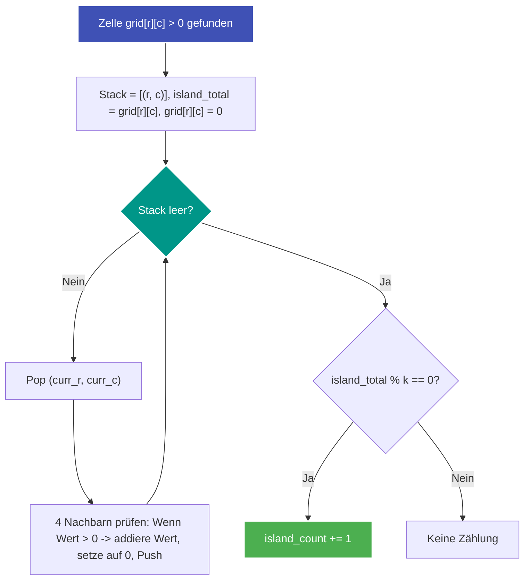

---
tags:
  - LeetCode
  - Array
  - DFS
  - BFS
  - Matrix
  - Medium
---


# LeetCode 3619: Count Islands With Total Value Divisible by K

- **Plattform:** [LeetCode #3619](https://leetcode.com/problems/count-islands-with-total-value-divisible-by-k/)
- **Schwierigkeit:** Medium
- **Kategorien:** Array, DFS, BFS, Matrix
- **Verwandte Konzepte:** [Flood Fill & Gitter-Traversierung](../glossary/flood-fill.md)

---

## Aufgabenstellung

Gegeben ist ein 2D-Ganzzahl-Array `grid` der Größe $m \times n$ und eine positive Ganzzahl $k$.
- Eine Zelle mit Wert `0` stellt Wasser dar.
- Eine Zelle mit Wert $> 0$ stellt Land dar und trägt den entsprechenden Wert.

Eine **Insel** ist eine maximal 4-fach orthogonal zusammenhängende Gruppe von Landzellen. Der **Gesamtwert einer Insel** ist die Summe der Werte aller ihrer Landzellen.

Gesucht ist die Anzahl aller Inseln, deren **Gesamtwert ohne Rest durch $k$ teilbar ist** ($\text{Inselwert} \pmod k == 0$).

### Beispiele

```text
Input: grid = [
  [0, 2, 1, 0, 0],
  [0, 5, 0, 0, 5],
  [0, 0, 1, 0, 0],
  [0, 1, 4, 7, 0],
  [0, 2, 0, 0, 8]
], k = 5
Output: 2
```

---

## Intuition & Lösungsansatz

### 1. Naive Idee (Rekursive DFS)
Jedes Mal, wenn ein Landfeld $grid[r][c] > 0$ gefunden wird, startet eine rekursive [Tiefensuche](../glossary/traversierung-bfs-dfs.md), summiert die Werte auf und setzt besuchte Zellen auf $0$.
- Problem: Bei großen Gittern führt der Rekursions-Call-Stack in Python schnell zu einem `RecursionError` oder erzeugt deutlichen Funktionsaufruf-Overhead.

### 2. Optimierte Kernidee (Iterative DFS mit Stack & In-Place-Markierung)
1. **Iterative [Tiefensuche](../glossary/traversierung-bfs-dfs.md):**
   - Wir verwalten einen expliziten Stack `[(row, col)]`.
   - Das Setzen der Zelle auf `0` (`grid[r][c] = 0`) geschieht **sofort beim Hinzufügen** zum Stack. Dies verhindert zuverlässig, dass dieselbe Zelle mehrfach auf den Stack gelegt wird.
2. **Summierung:**
   - Wir summieren alle Zellwerte der aktuellen Zusammenhangskomponente in einer Variablen `island_total`.
3. **Prüfung:**
   - Nach vollständiger Traversierung der Insel prüfen wir:
     $$\text{island\_total} \pmod k == 0$$
   - Ist dies erfüllt, inkrementieren wir den Insel-Zähler `island_count`.



---

## Implementierung (Python 3)

```python
from typing import List


class Solution:
    def countIslands(self, grid: List[List[int]], k: int) -> int:
        """Zählt Inseln, deren kumulierter Gesamtwert durch k teilbar ist.

        Args:
            grid: 2D-Gitter mit Landwerten (>0) und Wasser (0)
            k: Divisor

        Returns:
            Anzahl der gültigen Inseln
        """
        if not grid or not grid[0]:
            return 0

        rows = len(grid)
        cols = len(grid[0])
        directions = ((1, 0), (-1, 0), (0, 1), (0, -1))
        island_count = 0

        for r in range(rows):
            for c in range(cols):
                if grid[r][c] == 0:
                    continue

                # Neue Insel gefunden -> Iterative DFS
                stack = [(r, c)]
                island_total = grid[r][c]
                grid[r][c] = 0  # In-Place als besucht markieren

                while stack:
                    curr_r, curr_c = stack.pop()

                    for dr, dc in directions:
                        nr = curr_r + dr
                        nc = curr_c + dc

                        if 0 <= nr < rows and 0 <= nc < cols:
                            if grid[nr][nc] > 0:
                                island_total += grid[nr][nc]
                                grid[nr][nc] = 0  # Sofort markieren
                                stack.append((nr, nc))

                # Teilbarkeitsprüfung
                if island_total % k == 0:
                    island_count += 1

        return island_count
```

---

## Komplexitätsanalyse

| Dimension | Komplexität | Begründung |
| :--- | :--- | :--- |
| **[Zeitkomplexität](../glossary/o-notation.md)** | $\mathcal{O}(m \cdot n)$ | Jede Gitterzelle wird in der äußeren Schleife und in der DFS höchstens eine feste Anzahl von Malen betrachtet. |
| **[Speicherkomplexität](../glossary/o-notation.md)** | $\mathcal{O}(m \cdot n)$ | Der Stack fasst im Worst-Case maximal alle Zellen einer zusammenhängenden Insel. Keine zusätzliche Matrix erforderlich. |

---

## Edge Cases & Fallstricke

- [x] **Zelle direkt beim Push auf 0 setzen:** Setzt man `grid[nr][nc] = 0` erst beim `pop()`, können orthogonale Nachbarn dieselbe Zelle mehrfach in den Stack pushen $\to$ Memory Limit Exceeded / TLE.
- [x] **Inselwert genau 0:** Tritt laut Aufgabenstellung nicht auf (Land $> 0$), Modulo $0 \pmod k == 0$ wäre sonst trivial erfüllt.
- [x] **Einzelne isolierte Landzellen:** Bilden eine Insel der Größe 1, deren Wert direkt modulo $k$ geprüft wird.
