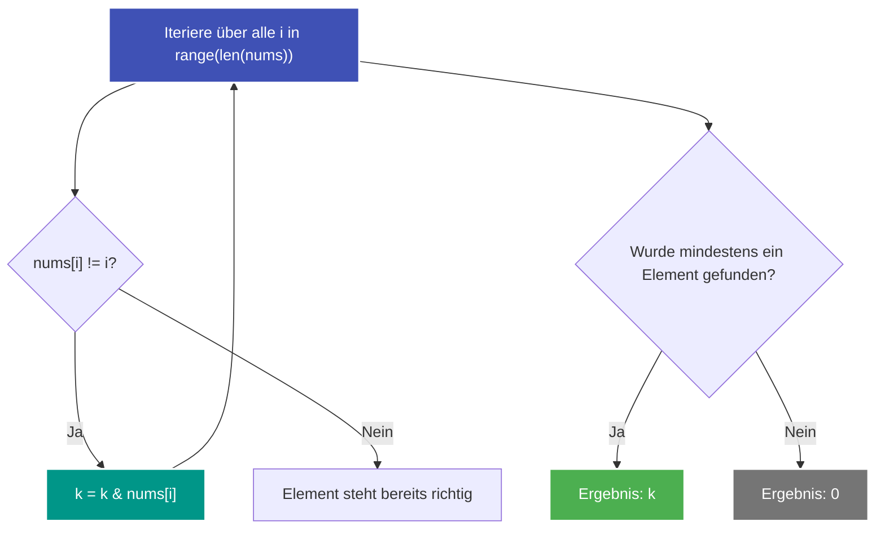

---
tags:
  - LeetCode
  - Array
  - Bit Manipulation
  - Sorting
  - Medium
---


# LeetCode 3644: Maximum K to Sort a Permutation

- **Plattform:** [LeetCode #3644](https://leetcode.com/problems/maximum-k-to-sort-a-permutation/)
- **Schwierigkeit:** Medium
- **Kategorien:** Array, Bit Manipulation, Sorting
- **Verwandte Konzepte:** [Bitweise Operationen & Bitmasken](../glossary/bit-manipulation.md)

---

## Aufgabenstellung

Gegeben ist ein Array `nums` der Länge $n$, das eine Permutation der Zahlen von $0$ bis $n - 1$ darstellt.

Zwei Elemente an den Indizes $i$ und $j$ dürfen genau dann miteinander getauscht werden, wenn für eine nicht-negative Ganzzahl $k$ gilt:
$$\text{nums}[i] \ \& \ k == k \quad \text{und} \quad \text{nums}[j] \ \& \ k == k$$

Gesucht ist das **maximale $k$**, mit dem das Array `nums` durch eine beliebige Anzahl erlaubter Tauschoperationen aufsteigend sortiert werden kann.
Ist das Array bereits sortiert, soll $0$ zurückgegeben werden.

### Beispiele

```text
Input:  nums = [0, 3, 2, 1]
Output: 1
Erklärung: nums[1] = 3 und nums[3] = 1 sind vertauscht. Beide erfüllen x & 1 == 1. Das maximale k ist 1.

Input:  nums = [0, 1, 3, 2]
Output: 2
Erklärung: nums[2] = 3 und nums[3] = 2. Beide erfüllen x & 2 == 2. Das maximale k ist 2.

Input:  nums = [3, 2, 1, 0]
Output: 0
Erklärung: 3 & 2 & 1 & 0 = 0.
```

---

## Intuition & Lösungsansatz

### 1. Mathematische Analyse der Bedingung
Die Bedingung $\text{val} \ \& \ k == k$ bedeutet:
- **Jedes Bit, das in $k$ als `1` gesetzt ist, muss auch in `val` als `1` gesetzt sein.**
- Mit anderen Worten: $k$ ist eine Teilmenge der Bits von `val`.

Damit Elemente, die sich nicht an ihrer korrekten Zielposition befinden ($\text{nums}[i] \neq i$), überhaupt bewegt oder getauscht werden können, muss $k$ eine Bit-Teilmenge **jedes einzelnen fehlsortierten Elements** sein.

### 2. Akkumulierendes bitweises AND
Damit ein $k$ für alle fehlsortierten Elemente gleichzeitig gültig ist, muss jedes 1-Bit in $k$ in allen $\text{nums}[i]$ mit $\text{nums}[i] \neq i$ vorhanden sein.

Das größtmögliche solche $k$ ist exakt das **bitweise AND aller fehlsortierten Zahlen**:
$$k = \bigwedge_{i: \text{nums}[i] \neq i} \text{nums}[i]$$

Ist kein einziges Element fehlsortiert (die Liste ist bereits sortiert), greift die Aufgabenbedingung: Rückgabe $0$.



---

## Implementierung (Python 3)

```python
from typing import List, Optional


class Solution:
    def maxK(self, nums: List[int]) -> int:
        """Findet das maximale k, sodass fehlsortierte Elemente über Bitwise-AND getauscht werden können.

        Args:
            nums: Permutation von 0 bis n - 1

        Returns:
            Maximaler ganzzahliger Wert k (oder 0, falls bereits sortiert)
        """
        ans: Optional[int] = None

        for i, val in enumerate(nums):
            if val != i:
                if ans is None:
                    ans = val
                else:
                    ans &= val

        return 0 if ans is None else ans
```

---

## Komplexitätsanalyse

| Dimension | Komplexität | Begründung |
| :--- | :--- | :--- |
| **[Zeitkomplexität](../glossary/o-notation.md)** | $\mathcal{O}(n)$ | Ein einziger linearer Durchlauf über das Array der Länge $n$. |
| **[Speicherkomplexität](../glossary/o-notation.md)** | $\mathcal{O}(1)$ | Es wird lediglich eine Akkumulator-Variable `ans` gepflegt. |

---

## Edge Cases & Fallstricke

- [x] **Bereits sortiertes Array:** Bleibt `ans is None`, wird per Aufgabenstellung $0$ zurückgegeben.
- [x] **Nur zwei vertauschte Elemente:** Das Ergebnis ist schlicht `nums[i] & nums[j]`.
- [x] **Kein gemeinsames Bit:** Haben fehlsortierte Elemente keine gemeinsame 1 (z. B. 2 (`10`) und 1 (`01`)), fällt das bitweise AND auf $0$ ab.
