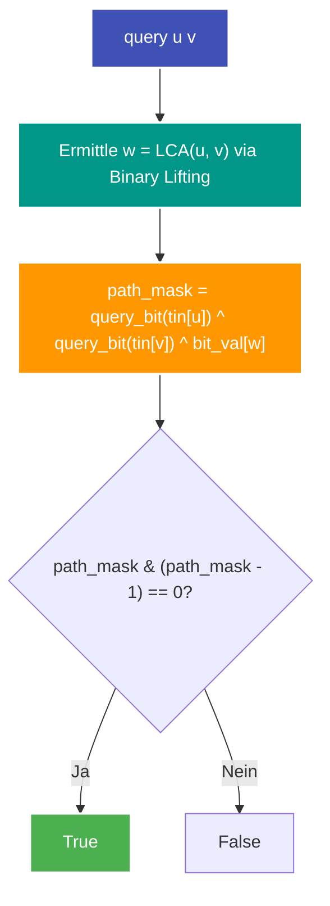

---
tags:
  - LeetCode
  - Tree
  - Graph
  - Euler Tour
  - Binary Lifting
  - LCA
  - Fenwick Tree
  - Bit Manipulation
  - Hard
---


# LeetCode 3841: Palindromic Path Queries in a Tree

- **Plattform:** [LeetCode #3841](https://leetcode.com/problems/palindromic-path-queries-in-a-tree/)
- **Schwierigkeit:** Hard
- **Kategorien:** Tree, Graph, Euler Tour, [Binary Lifting](../glossary/advanced-tree-techniques.md), LCA, Fenwick Tree, Bit Manipulation
- **Verwandte Konzepte:** [Fortgeschrittene Baum-Techniken](../glossary/advanced-tree-techniques.md) | [Bitweise Operationen](../glossary/bit-manipulation.md) | [Adjazenzliste](../glossary/adjazenzliste.md)

---

## Aufgabenstellung

Gegeben ist ein ungerichteter Baum mit $n$ Knoten (nummeriert von $0$ bis $n - 1$) und $n - 1$ Kanten `edges`. Jeder Knoten $i$ trägt einen Buchstaben aus einem String `s`.

Es gibt zwei Typen von Abfragen in `queries`:
1. `"update u c"`: Ändere den Buchstaben an Knoten $u$ auf das Zeichen $c$.
2. `"query u v"`: Prüfe, ob die Zeichen entlang des einfachen Pfades zwischen Knoten $u$ und Knoten $v$ so umgeordnet werden können, dass sie ein **Palindrom** bilden.

Gib eine Liste von booleschen Werten zurück, die jede `"query"`-Abfrage beantwortet.

---

## Intuition & Lösungsansatz

### 1. Palindrom-Bedingung über 26-Bit-Masken
Ein String lässt sich genau dann zu einem Palindrom permutieren, wenn **höchstens ein Buchstabe** eine ungerade Häufigkeit aufweist.
- Jeder Buchstabe `'a' + k` entspricht dem Bit $1 \ll k$.
- Auf dem Pfad heben sich doppelte Buchstaben via XOR auf ($x \oplus x = 0$).
- Eine Maske hat höchstens ein gesetztes Bit, wenn:
  $$\text{mask} \ \& \ (\text{mask} - 1) == 0$$

### 2. Pfad-Aggregation auf Bäumen
Der einfache Pfad zwischen $u$ und $v$ verläuft über ihren kleinsten gemeinsamen Vorfahren $\text{LCA}(u, v)$:
$$\text{Pfad-XOR}(u, v) = \text{Weg}(\text{Root} \to u) \oplus \text{Weg}(\text{Root} \to v) \oplus \text{Knoten-XOR}(\text{LCA}(u, v))$$

*Wichtig:* Der LCA-Knoten gehört zum Pfad, würde sich aber durch die Überlagerung beider Wurzelpfade zweimal auslöschen. Deshalb muss sein eigener Knotenwert einmal wieder hinzugerechnet werden.

### 3. Dynamische Updates via Euler-Tour & Fenwick-Baum
Da Zeichen an Knoten dynamisch aktualisiert werden, reicht eine statische Prefix-XOR-Berechnung nicht aus:
1. **[Euler-Tour](../glossary/advanced-tree-techniques.md) (Abflachen):**
   - Beim Betreten eines Knotens $u$ in der DFS notieren wir $\text{tin}[u]$.
   - Beim Verlassen notieren wir $\text{tout}[u]$.
2. **[Fenwick-Baum](../glossary/advanced-tree-techniques.md) ([Binary Indexed Tree](../glossary/advanced-tree-techniques.md)):**
   - Ein Punkt-Update am Knoten $u$ invertiert den XOR-Beitrag im Fenwick-Baum an den Positionen $\text{tin}[u]$ und $\text{tout}[u]$.
   - Die Präfixabfrage `query_bit(tin[u])` liefert den kumulierten Pfad-XOR-Wert von der Wurzel bis zu Knoten $u$ in $\mathcal{O}(\log n)$.
3. **LCA via Binary Lifting:**
   - Vorberechnung von $\text{up}[u][j]$ in $\mathcal{O}(n \log n)$, um den LCA zweier Knoten in $\mathcal{O}(\log n)$ zu finden.



---

## Implementierung (Python 3)

```python
import math
from typing import List


class Solution:
    def solve(
        self,
        n: int,
        edges: List[List[int]],
        s: str,
        queries: List[str],
    ) -> List[bool]:
        """Beantwortet Pfad-Palindrom-Abfragen auf einem dynamisch modifizierbaren Baum."""
        # 1. Adjazenzliste
        adj = [[] for _ in range(n)]
        for u, v in edges:
            adj[u].append(v)
            adj[v].append(u)

        char_mask = {chr(ord("a") + i): 1 << i for i in range(26)}

        max_log = max(1, math.ceil(math.log2(n))) if n > 1 else 1
        up = [[-1] * max_log for _ in range(n)]
        depth = [0] * n

        tin = [0] * n
        tout = [0] * n
        timer = 0
        bit_val = [1 << (ord(char) - ord("a")) for char in s]

        # 2. DFS für Euler-Tour und Binary Lifting
        def dfs(u: int, p: int, d: int) -> None:
            nonlocal timer
            tin[u] = timer
            timer += 1
            depth[u] = d

            up[u][0] = p
            for j in range(1, max_log):
                if up[u][j - 1] != -1:
                    up[u][j] = up[up[u][j - 1]][j - 1]

            for neighbor in adj[u]:
                if neighbor != p:
                    dfs(neighbor, u, d + 1)
            tout[u] = timer

        dfs(0, -1, 0)

        # 3. Fenwick-Baum (XOR)
        tree = [0] * (n + 1)

        def update(i: int, delta: int) -> None:
            i += 1
            while i <= n:
                tree[i] ^= delta
                i += i & -i

        def query_bit(i: int) -> int:
            res = 0
            i += 1
            while i > 0:
                res ^= tree[i]
                i -= i & -i
            return res

        for i in range(n):
            update(tin[i], bit_val[i])
            update(tout[i], bit_val[i])

        # 4. LCA via Binary Lifting
        def get_lca(u: int, v: int) -> int:
            if depth[u] < depth[v]:
                u, v = v, u
            for j in range(max_log - 1, -1, -1):
                if depth[u] - (1 << j) >= depth[v]:
                    u = up[u][j]
            if u == v:
                return u
            for j in range(max_log - 1, -1, -1):
                if up[u][j] != -1 and up[u][j] != up[v][j]:
                    u = up[u][j]
                    v = up[v][j]
            return up[u][0]

        # 5. Queries bearbeiten
        answer = []
        for q in queries:
            parts = q.split()
            op = parts[0]
            u = int(parts[1])

            if op == "update":
                new_char = parts[2]
                new_mask = char_mask[new_char]
                old_mask = bit_val[u]
                if old_mask != new_mask:
                    delta = old_mask ^ new_mask
                    update(tin[u], delta)
                    update(tout[u], delta)
                    bit_val[u] = new_mask
            else:
                v = int(parts[2])
                w = get_lca(u, v)
                path_mask = (
                    query_bit(tin[u]) ^ query_bit(tin[v]) ^ bit_val[w]
                )
                answer.append((path_mask & (path_mask - 1)) == 0)

        return answer
```

---

## Komplexitätsanalyse

| Dimension | Komplexität | Begründung |
| :--- | :--- | :--- |
| **[Zeitkomplexität](../glossary/o-notation.md) (Aufbau)** | $\mathcal{O}(n \log n)$ | DFS, Binary Lifting Tabelle der Größe $n \times \log_2 n$ initialisieren. |
| **[Zeitkomplexität](../glossary/o-notation.md) (Pro Query)** | $\mathcal{O}(\log n)$ | LCA-Suche $\mathcal{O}(\log n)$, Fenwick-Query/-Update $\mathcal{O}(\log n)$. |
| **Speicherkomplexität** | $\mathcal{O}(n \log n)$ | Tabelle für Binary Lifting und Euler-Tour Arrays. |

---

## Edge Cases & Fallstricke

- [x] **Pfad zu sich selbst ($u == v$):** Ergibt immer ein einstelliges Zeichen (Palindrom).
- [x] **LCA-Knoten nicht vergessen:** Da $\text{query\_bit}(u) \oplus \text{query\_bit}(v)$ den LCA-Knoten doppelt XORt, muss `^ bit_val[w]` zwingend ergänzt werden.
- [x] **Unveränderte Updates:** Wird ein Buchstabe mit demselben Zeichen aktualisiert, verhindert die `old_mask != new_mask` Prüfung unnötige BIT-Updates.
