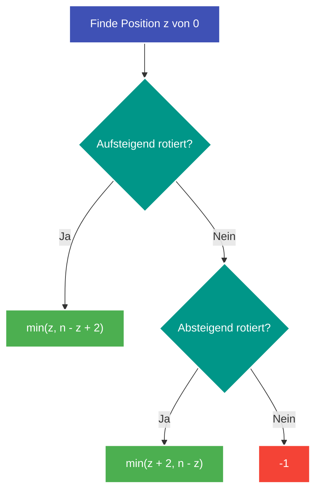

---
tags:
  - LeetCode
  - Array
  - Math
  - Medium
---


# LeetCode 3942: Minimum Operations to Sort a Permutation

- **Plattform:** [LeetCode #3942](https://leetcode.com/problems/minimum-operations-to-sort-a-permutation/)
- **Schwierigkeit:** Medium
- **Kategorien:** Array, Math, Permutation
- **Verwandte Konzepte:** [Zyklische Permutationen & Rotationen](../glossary/cyclic-permutations.md)

---

## Aufgabenstellung

Gegeben ist ein Array `nums` der Länge $n$, das eine Permutation der Zahlen von $0$ bis $n - 1$ darstellt.

Erlaubt sind ausschließlich zwei Arten von Operationen:
1. **Zyklische Linksrotation:** Das erste Element wird entfernt und ganz hinten angehängt ($[x_0, x_1, \dots, x_{n-1}] \to [x_1, \dots, x_{n-1}, x_0]$).
2. **Vollständige Umkehrung (Reverse):** Die Reihenfolge aller Elemente des gesamten Arrays wird umgekehrt.

Gesucht ist die **minimale Anzahl an Operationen**, um `nums` aufsteigend zu sortieren ($[0, 1, \dots, n-1]$). Falls die Sortierung unmöglich ist, soll $-1$ zurückgegeben werden.

### Beispiele

```text
Input:  nums = [0, 1, 2]
Output: 0
Erklärung: Das Array ist bereits sortiert.

Input:  nums = [0, 2, 1]
Output: 2
Erklärung: nums ist eine absteigende Rotation mit 0 an Index 0 -> min(0 + 2, 3 - 0) = 2.
```

---

## Intuition & Lösungsansatz

### 1. Invarianz der zyklischen Nachbarschaften
Da nur Linksrotationen und vollständige Umkehrungen erlaubt sind, bleibt die relative zyklische Nachbarschaft der Elemente zueinander stets erhalten:
- Durch Rotationen ändert sich die relative Reihenfolge überhaupt nicht.
- Durch Umkehren wird die relative Reihenfolge exakt gespiegelt.

Das bedeutet: **Ein Array kann genau dann sortiert werden, wenn es bereits eine [zyklische Rotation](../glossary/cyclic-permutations.md) der aufsteigenden Folge ODER der absteigenden Folge ist!**

### 2. Fallunterscheidung anhand der Position von $0$
Sei $z = \text{nums.index}(0)$ die Position der Zahl $0$.

1. **Fall 1: Aufsteigende [[zyklische Rotation](../glossary/cyclic-permutations.md)](../glossary/cyclic-permutations.md)**
   $$\text{nums}[(z + i) \pmod n] == i \quad \forall i \in \{0, \dots, n-1\}$$
   - Option A: Nur Linksrotationen $\to z$ Operationen.
   - Option B: Array umkehren, rotieren, wieder umkehren $\to n - z + 2$ Operationen.
   - Kosten: $\min(z, n - z + 2)$.

2. **Fall 2: Absteigende zyklische Rotation**
   $$\text{nums}[(z - i) \pmod n] == i \quad \forall i \in \{0, \dots, n-1\}$$
   - Steht die 0 an Index 0 ($z = 0$): 1 Umkehrung genügt, da $[0, n-1, \dots, 1]$ nach dem Umkehren sofort sortiert ist.
   - Andernfalls: $\min(z + 2, n - z)$.

3. **Fall 3: Weder noch**
   - Das Array kann mit den erlaubten Operationen niemals sortiert werden $\to$ Rückgabe: $-1$.



---

## Implementierung (Python 3)

```python
from typing import List


class Solution:
    def solve(self, nums: List[int]) -> int:
        """Berechnet die minimale Operationsanzahl (Rotate / Reverse) zum Sortieren.

        Args:
            nums: Permutation von 0 bis n - 1

        Returns:
            Minimale Anzahl Züge oder -1
        """
        n = len(nums)
        zero_pos = nums.index(0)

        # 1. Aufsteigende Rotation prüfen
        if all(nums[(zero_pos + i) % n] == i for i in range(n)):
            return min(zero_pos, n - zero_pos + 2)

        # 2. Absteigende Rotation prüfen
        if all(nums[(zero_pos - i) % n] == i for i in range(n)):
            return min(zero_pos + 2, n - zero_pos)

        # 3. Keine gültige zyklische Ordnung
        return -1
```

---

## Komplexitätsanalyse

| Dimension | Komplexität | Begründung |
| :--- | :--- | :--- |
| **[Zeitkomplexität](../glossary/o-notation.md)** | $\mathcal{O}(n)$ | Index-Suche der 0 und zwei lineare Überprüfungen via Generator. |
| **[Speicherkomplexität](../glossary/o-notation.md)** | $\mathcal{O}(1)$ | Es werden keine Hilfsarrays angelegt. |

---

## Edge Cases & Fallstricke

- [x] **Bereits sortiert ($z = 0$):** $\min(0, n + 2) = 0$.
- [x] **Permutationen mit Störungen:** Jede echte Vertauschung, die die relative Zyklusordnung bricht (z. B. Paritäts-Fehler), wird sofort mit $-1$ beantwortet.
- [x] **Array der Länge 1 oder 2:** Wird durch die zyklische Modulo-Prüfung deterministisch gehandhabt.
