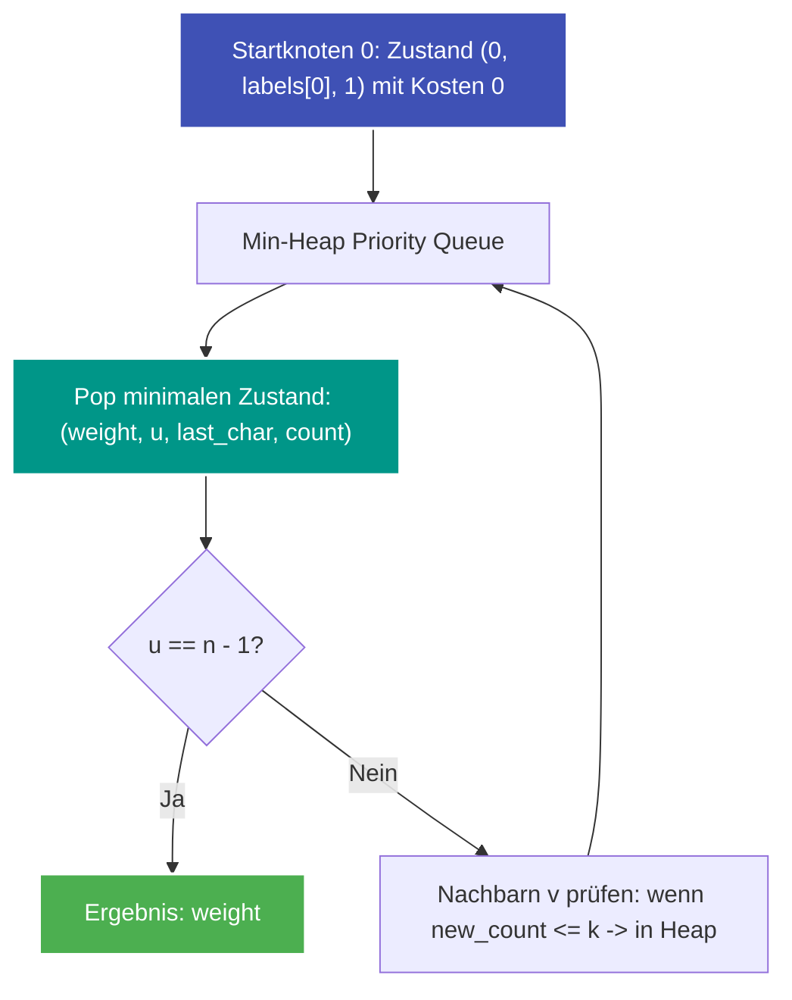

---
tags:
  - LeetCode
  - Graph
  - Shortest Path
  - Dijkstra
  - State Space
  - Hard
---

# LeetCode 3970: Shortest Path With At Most K Consecutive Identical Characters

- **Plattform:** [LeetCode #3970](https://leetcode.com/problems/shortest-path-with-at-most-k-consecutive-identical-characters/)
- **Schwierigkeit:** Hard
- **Kategorien:** Graph, Shortest Path, Dijkstra, State Space
- **Verwandte Konzepte:** [Zustandsbasierter Dijkstra](../glossary/state-space-dijkstra.md) | [Min-Heap](../glossary/min-heap-sweep-line.md) | [Adjazenzliste](../glossary/adjazenzliste.md)

---

## Aufgabenstellung

Gegeben ist ein gerichteter, gewichteter Graph mit $n$ Knoten (nummeriert von $0$ bis $n - 1$) und einer Liste von Kanten `edges`, wobei $\text{edges}[i] = [u_i, v_i, w_i]$. Jeder Knoten $i$ trägt ein Label aus einem String `labels`.

Gesucht ist das **minimale Kantengewicht** eines Pfades von Knoten $0$ nach Knoten $n - 1$, mit einer zentralen Nebenbedingung:
- Entlang des Pfades dürfen **höchstens $k$ Knoten mit demselben Zeichen hintereinander** besucht werden.

Falls kein gültiger Pfad existiert, soll $-1$ zurückgegeben werden.

### Beispiele

```text
Input:  n = 3, edges = [[0, 1, 1], [1, 2, 1], [0, 2, 3]], labels = "aab", k = 1
Output: 3
Erklärung: 
Der Pfad 0 -> 1 -> 2 hat Kosten 1 + 1 = 2, besucht aber zwei 'a' hintereinander (Knoten 0 und 1). 
Da k = 1 ist, ist dieser Pfad ungültig. 
Der direkte Pfad 0 -> 2 hat Kosten 3 und besucht 'a' gefolgt von 'b' (Reihenfolge gültig). Antwort: 3.
```

---

## Intuition & Lösungsansatz

### 1. Warum klassischer Dijkstra versagt
Ein Standard-Dijkstra speichert pro Knoten nur `dist[u]`. Hier wäre der Pfad `0 -> 1` mit Kosten 1 günstiger als ein Umweg, verbaut aber den weiteren Weg zu `2`, da die Anzahl aufeinanderfolgender `'a'` bereits das Limit $k=1$ erreicht hat.

### 2. State-Space Expansion & Zustandsraum-Reduktion
Wir erweitern den Knotenbegriff auf ein 3-Tupel:
$$\text{Zustand} = (\text{u}, \text{last\_char}, \text{count})$$

- `u`: Aktueller Knoten.
- `last\_char`: Das Zeichen des aktuellen/letzten Knotens.
- `count`: Wie oft dieses Zeichen bisher unmittelbar hintereinander besucht wurde.

Statt den gesamten Pfad mitzuschleppen, reduzieren wir die Historie exakt auf `(last_char, count)`.
- Trifft die Kante auf denselben Buchstaben (`labels[v] == last_char`): $\text{new\_count} = \text{count} + 1$.
- Trifft die Kante auf einen neuen Buchstaben: $\text{new\_count} = 1$.
- Ist $\text{new\_count} \le k$, wird der Zustand in die Priority Queue eingereiht.



---

## Implementierung (Python 3)

```python
import heapq
from typing import Dict, List, Tuple


class Solution:
    def solve(
        self, n: int, edges: List[List[int]], labels: str, k: int
    ) -> int:
        """Findet den kürzesten Pfad von 0 nach n-1 mit maximal k aufeinanderfolgenden gleichen Zeichen.

        Args:
            n: Anzahl der Knoten
            edges: Liste gerichteter Kanten [u, v, weight]
            labels: String der Länge n mit Knoten-Labeln
            k: Maximale Anzahl gleicher Zeichen in Folge

        Returns:
            Minimale Kosten oder -1
        """
        # 1. Adjazenzliste
        adj = [[] for _ in range(n)]
        for u, v, w in edges:
            adj[u].append((v, w))

        # Startzustand: Knoten 0 hat bereits 1 Vorkommen seines Labels
        if k < 1:
            return -1

        initial_label = labels[0]
        # Priority Queue: (weight, u, last_char, count)
        pq = [(0, 0, initial_label, 1)]

        # min_costs[(u, last_char, count)] = minimales Gewicht
        min_costs: Dict[Tuple[int, str, int], int] = {
            (0, initial_label, 1): 0
        }

        while pq:
            weight, u, last_char, count = heapq.heappop(pq)

            # Erstes Erreichen des Zielknotens ist im Min-Heap optimal
            if u == n - 1:
                return weight

            # Veraltete Heap-Einträge überspringen
            state_key = (u, last_char, count)
            if weight > min_costs.get(state_key, float("inf")):
                continue

            for v, w in adj[u]:
                next_char = labels[v]
                next_count = (count + 1) if next_char == last_char else 1

                if next_count <= k:
                    next_weight = weight + w
                    target_key = (v, next_char, next_count)

                    if next_weight < min_costs.get(
                        target_key, float("inf")
                    ):
                        min_costs[target_key] = next_weight
                        heapq.heappush(
                            pq, (next_weight, v, next_char, next_count)
                        )

        return -1
```

---

## Komplexitätsanalyse

| Dimension | Komplexität | Begründung |
| :--- | :--- | :--- |
| **Zeitkomplexität** | $\mathcal{O}((E \cdot k) \log(V \cdot k))$ | Es gibt maximal $V \cdot k$ Zustände. Jeder Zustand hat höchstens die ausgehenden Kanten des Knotens. |
| **Speicherkomplexität** | $\mathcal{O}(V \cdot k)$ | Für die Zustandsdistanz-Map `min_costs` und den Min-Heap. |

---

## Edge Cases & Fallstricke

- [x] **$k = 0$:** Unmöglich, da bereits der Startknoten 1 Zeichen belegt $\to -1$.
- [x] **Startknoten ist Zielknoten ($n = 1$):** Gibt sofort 0 zurück.
- [x] **Zyklische Graphen:** Durch `min_costs`-Relaxation und positive Kantengewichte sind Endlosschleifen ausgeschlossen.
