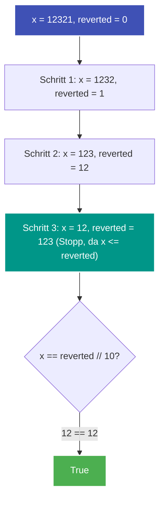

---
tags:
  - LeetCode
  - Math
  - Palindrome
  - Easy
---


# LeetCode 9: Palindrome Number

- **Plattform:** [LeetCode #9](https://leetcode.com/problems/palindrome-number/)
- **Schwierigkeit:** Easy
- **Kategorien:** Math
- **Verwandte Konzepte:** [Mathematische Zahlenumkehr](../glossary/math-number-reversal.md)

---

## Aufgabenstellung

Gegeben ist eine Ganzzahl `x`. Gib `True` zurück, wenn `x` ein Palindrom ist, andernfalls `False`.

Eine Zahl ist ein Palindrom, wenn sie vorwärts wie rückwärts denselben Wert ergibt (z. B. $121$).

### Beispiele

```text
Input:  x = 121
Output: true

Input:  x = -121
Output: false
Erklärung: Von links nach rechts: -121. Von rechts nach links: 121-. Kein Palindrom.

Input:  x = 10
Output: false
Erklärung: Von rechts nach links: 01. Kein Palindrom.
```

*Zusatzaufgabe (Follow-up):* Kannst du das Problem lösen, **ohne** die Ganzzahl in einen String umzuwandeln?

---

## Intuition & Lösungsansatz

### 1. Naive Idee (String-Konvertierung)
Man wandelt die Zahl in einen String um und vergleicht mit dem gespiegelten String:
```python
return str(x) == str(x)[::-1]
```
- Problem: Allokiert unnötig Speicher auf dem Heap und ignoriert die mathematische Aufgabenstellung.

### 2. Optimierte Kernidee (Halbe mathematische Spiegelung)
Wir kehren die Ziffern der Zahl mathematisch um. Um das Risiko eines Ganzzahlüberlaufs in Sprachen mit festen Bitbreiten zu vermeiden und Zeit zu sparen, spiegeln wir **nur die hintere Hälfte** der Zahl:

1. **Vorab-Ausschlüsse:**
   - Negative Zahlen können keine Palindrome sein (Minuszeichen nur links).
   - Zahlen, die auf $0$ enden (außer $0$ selbst), können keine Palindrome sein, da keine positive Zahl mit $0$ beginnt.
2. **Spiegelungs-Schleife:**
   - Solange $x > \text{reverted\_number}$, holen wir die letzte Ziffer mit $x \pmod{10}$, hängen sie an `reverted_number` an und teilen $x$ durch $10$.
3. **Auswertung:**
   - Gerade Ziffernanzahl (z. B. $1221$): Am Ende ist $x == 12$ und $\text{reverted} == 12$.
   - Ungerade Ziffernanzahl (z. B. $12321$): Am Ende ist $x == 12$ und $\text{reverted} == 123$. Wir schneiden die mittlere Ziffer mit $\text{reverted} \mathbin{/\!\!/} 10$ ab.



---

## Implementierung (Python 3)

```python
class Solution:
    def isPalindrome(self, x: int) -> bool:
        """Prüft, ob eine Ganzzahl ein Palindrom ist, ohne String-Konvertierung.

        Args:
            x: Zu prüfende Ganzzahl

        Returns:
            True, wenn x ein Palindrom ist, sonst False
        """
        # Negative Zahlen und Vielfache von 10 (außer 0) ausschließen
        if x < 0 or (x % 10 == 0 and x != 0):
            return False

        reverted_number = 0
        while x > reverted_number:
            reverted_number = reverted_number * 10 + x % 10
            x //= 10

        # Bei gerader Ziffernzahl: x == reverted_number
        # Bei ungerader Ziffernzahl: x == reverted_number // 10
        return x == reverted_number or x == reverted_number // 10
```

---

## Komplexitätsanalyse

| Dimension | Komplexität | Begründung |
| :--- | :--- | :--- |
| **[Zeitkomplexität](../glossary/o-notation.md)** | $\mathcal{O}(\log_{10} n)$ | Wir teilen die Zahl in jeder Iteration durch $10$. Da wir nur die halbe Zahl spiegeln, benötigt die Schleife ca. $\frac{1}{2} \log_{10} n$ Schritte. |
| **[Speicherkomplexität](../glossary/o-notation.md)** | $\mathcal{O}(1)$ | Es werden nur wenige Integer-Variablen alloziert. |

---

## Edge Cases & Fallstricke

- [x] **Zahl 0:** $0$ ist ein Palindrom; die Ausnahme `x % 10 == 0 and x != 0` stellt sicher, dass $0$ nicht fälschlich abgewiesen wird.
- [x] **Negative Zahlen:** Immer `False`.
- [x] **Einstellige Zahlen ($1 \dots 9$):** Die Schleife bricht sofort ab ($x \le \text{reverted}$ nach erster Ziffer), und $x == \text{reverted} \mathbin{/\!\!/} 10$ ($0 == 0$) ergibt korrekt `True`.
